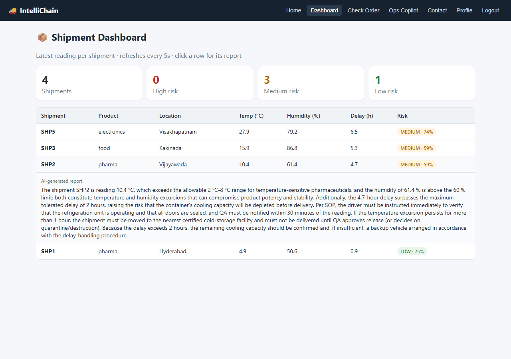
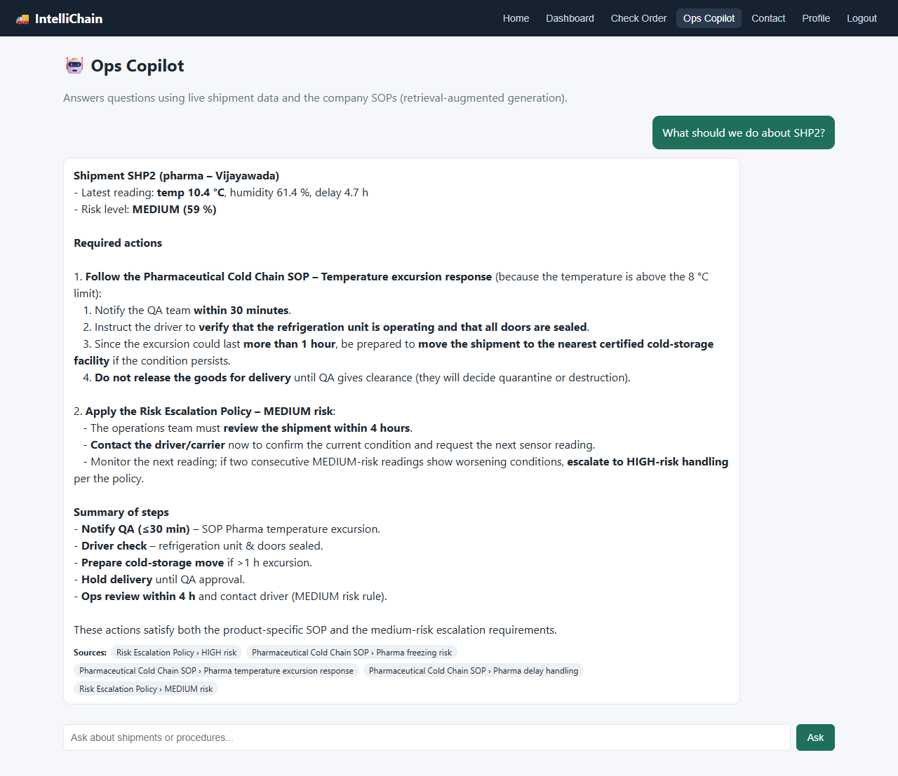

<div align="center">

# IntelliChain

**AI-powered supply-chain monitoring: an ML model scores IoT shipment readings, and a RAG copilot tells the operations team what to do.**


</div>

---

## The problem

Vaccines, food and electronics can be ruined in transit by heat, humidity or long delays, and operations teams usually find out only after delivery. The right response also depends on the product: 12 °C is a crisis for insulin but normal for furniture, and every company has its own procedures (SOPs) for each case.

IntelliChain does three things:

1. **Collects sensor readings** from shipments in transit through a REST API.
2. **Scores each reading with a machine-learning model** that has learned product-specific risk (LOW / MEDIUM / HIGH).
3. **Tells the team what to do.** It writes an incident report grounded in the company SOPs, and an **Ops Copilot** answers questions such as *"What should we do about SHP2?"* using live shipment data plus retrieved SOP sections, with citations.

## Screenshots

| Dashboard (live risk scores, click a row for its report) | Ops Copilot (RAG over SOPs + live data) |
|---|---|
|  |  |

<sub>Screenshots use simulated shipments. Reports and answers are generated by `openai/gpt-oss-120b` on Groq.</sub>

## Architecture

```
 IoT sensors / simulate_iot.py
          │ POST /api/sensor  (X-API-Key)
          ▼
 ┌──────────────────────── Flask REST API ────────────────────────┐
 │                                                                │
 │  Random Forest risk model ──► LOW / MEDIUM / HIGH + confidence │
 │          │                                                     │
 │          ▼                                                     │
 │  Report generator ──► retrieve SOP sections ──► LLM (Groq)     │
 │          │              (bge-small embeddings,  (or template   │
 │          ▼               product filter)         fallback)     │
 │  SQLite (SQLAlchemy): users, shipment readings, reports        │
 │                                                                │
 │  Ops Copilot: question ──► live shipment lookup + SOP retrieval│
 │                        ──► grounded prompt ──► answer + sources│
 └────────────────────────────────────────────────────────────────┘
          │ JSON (Bearer token)
          ▼
 React frontend: Dashboard · Check Order · Ops Copilot · Login/Register
```

## 1. Machine learning: shipment risk model

Real cold-chain sensor data isn't publicly available, so [`ml/generate_data.py`](backend/ml/generate_data.py) **simulates 6,000 shipments**. Each product type has its own safe ranges:

| Product | Temperature | Max humidity | Delay tolerance |
|---|---|---|---|
| Pharma | 2–8 °C | 60 % | 2 h |
| Food | 0–15 °C | 85 % | 4 h |
| Electronics | 5–35 °C | 55 % | 12 h |
| General | 0–40 °C | 90 % | 24 h |

A hidden spoilage score grows as readings leave the safe range, including an interaction term (heat hurts more the longer the delay). **Noise is added so the classes overlap**, so the model has to learn the pattern instead of one threshold.

[`ml/train.py`](backend/ml/train.py) compares three models with 5-fold cross-validation, using a scikit-learn `Pipeline` (scaling + one-hot encoding):

| Model | CV macro F1 |
|---|---|
| Logistic Regression | 0.61 |
| Gradient Boosting | 0.77 |
| **Random Forest** ✅ | **0.80** |

**Held-out test set (1,200 rows): accuracy 88.5 %, macro F1 0.83**

| Actual ↓ / Predicted → | LOW | MEDIUM | HIGH |
|---|---|---|---|
| **LOW** | 732 | 54 | 1 |
| **MEDIUM** | 40 | 123 | 16 |
| **HIGH** | 1 | 26 | 207 |

- **MEDIUM is the hardest class.** It sits between the other two and is the smallest class (15 %). Adding `class_weight="balanced"` raised MEDIUM recall from **0.46 to 0.69** and macro F1 from 0.80 to 0.83.
- **The model rarely confuses LOW and HIGH** (2 of 1,200 cases); almost every error is with a neighbouring class.
- Logistic Regression does poorly because the risk boundaries are non-linear and depend on the product type.

## 2. RAG: retrieval over company SOPs

The [`knowledge/`](backend/knowledge) folder holds 4 sample SOP documents (pharma cold chain, food, electronics and general cargo, risk escalation). [`retriever.py`](backend/retriever.py) works like this:

1. **Chunking:** each document is split at its `##` headings, so each chunk is one self-contained procedure (16 chunks).
2. **Metadata:** an `Applies to:` line tags each document with product types. When a question is about a specific shipment, only that product's SOPs plus the general escalation policy are searched.
3. **Embeddings:** chunks are embedded locally with **BAAI/bge-small-en-v1.5** through `fastembed` (ONNX, so no GPU, PyTorch or API key is needed) and ranked by cosine similarity.
4. **Rules that always apply:** the escalation rule for a shipment's risk level is added by direct lookup, so it's never crowded out of the top results.

**Evaluation.** [`evaluate_retrieval.py`](backend/evaluate_retrieval.py) runs 16 labelled questions, each with the SOP section that should answer it:

| Retriever | recall@1 | recall@3 |
|---|---|---|
| TF-IDF (keyword baseline) | 69 % | 75 % |
| **bge-small embeddings** | **81 %** | **100 %** |

Keyword search fails on questions like *"electronics got wet in the truck"*: the answer is in "Electronics **humidity** response", which shares no words with the question. Embeddings match the meaning instead. The evaluation also showed that bge's optional query prefix *lowered* recall@1 on these documents, so it isn't used.

## 3. GenAI: reports and Ops Copilot

- **Incident reports:** for MEDIUM and HIGH readings, the top 3 retrieved SOP sections and the reading go to the LLM (**Groq**, running `openai/gpt-oss-120b` by default; **Gemini** is also supported) with instructions to recommend *only* actions found in the SOPs. LOW readings get a template report, which saves LLM calls.
- **Ops Copilot (`POST /api/assistant`)** builds its context from two sources:
  - **live data:** the latest reading of any shipment named in the question (e.g. "SHP2") plus every shipment currently at risk.
  - **knowledge:** SOP sections retrieved for the question **and for each shipment it is about**, so one product's SOPs can't crowd out another's (this fixed a real bug where electronics and food SOPs hid the pharma one), plus the escalation rule for each risk level.

  The prompt tells the model to answer only from that context, check each shipment against *its own* product's limits, cite SOP sections in `[brackets]`, and say when it doesn't know. The API returns the answer **plus its sources**, so users can check them.
- **Prompt rules from testing with the real model.** One reading can't show how long a problem has lasted, but the model first wrote *"because the excursion has persisted longer than one hour..."*. The prompts now require time-based SOP rules to be stated as conditions (*"if the excursion lasts more than 1 hour..."*).
- **Works without an API key.** If no key is set or the API call fails, reports use a template and the Copilot returns the retrieved context. The app never crashes because of the LLM.

## API

| Method | Endpoint | Auth | Purpose |
|---|---|---|---|
| GET | `/api/health` | – | Health check (shows the active LLM provider) |
| POST | `/api/register` | – | Create account (password hashed) |
| POST | `/api/login` | – | Returns a signed token (valid 8 h) |
| GET | `/api/me` | Bearer | Current user |
| POST | `/api/sensor` | `X-API-Key` | Submit a reading; returns risk, confidence and report |
| GET | `/api/dashboard` | Bearer | Latest reading per shipment + risk summary |
| GET | `/api/shipments/<id>` | Bearer | Full reading history for one shipment |
| POST | `/api/assistant` | Bearer | Ask the Ops Copilot a question |

```bash
curl -X POST http://127.0.0.1:5000/api/sensor \
  -H "Content-Type: application/json" -H "X-API-Key: dev-device-key" \
  -d '{"shipment_id":"SHP2","product_type":"pharma","location":"Vijayawada","temperature":12.5,"humidity":60,"delay_hours":3}'
```

Response without an LLM key (with a key, `report` is written by the LLM and `report_source` is `"llm"`):

```json
{
  "shipment_id": "SHP2",
  "product_type": "pharma",
  "risk": "MEDIUM",
  "risk_probability": 0.594,
  "report": "Shipment SHP2 (pharma) at Vijayawada. Temperature 12.5 °C, humidity 60.0 %, delay 3.0 h. Risk: MEDIUM (model confidence 59%). See SOP: Pharmaceutical Cold Chain SOP - Pharma temperature excursion response.",
  "report_source": "template"
}
```

## Getting started

```bash
git clone https://github.com/JahnaviPasupuleti45/IntelliChain.git
cd IntelliChain
cp .env.example .env          # optional: add your free Groq API key
```

**Backend** (Python 3.12):

```bash
cd backend
python -m venv .venv
# Windows: .venv\Scripts\activate    macOS/Linux: source .venv/bin/activate
pip install -r requirements.txt
python app.py
```

The first start trains the model and downloads the embedding model (~67 MB), which takes about a minute. Later starts are fast.

**Send simulated sensor data** (second terminal):

```bash
python simulate_iot.py --rounds 5
```

**Frontend** (Node 18+):

```bash
cd frontend
npm install
npm start
```

Open http://localhost:3000, register, log in and open the **Dashboard** and **Ops Copilot**.

### Enable the LLM (optional, free)

Create a free key at [console.groq.com/keys](https://console.groq.com/keys), then copy `.env.example` to `.env` in the repo root and add it:

```bash
GROQ_API_KEY=your-key
```

The backend reads `.env` on startup (it is git-ignored, so the key is never committed). `/api/health` then returns `"llm_provider": "groq"`. To use Google Gemini instead, set `GEMINI_API_KEY` ([get one here](https://aistudio.google.com/apikey)) and leave `GROQ_API_KEY` empty. To change the Groq model, set `GROQ_MODEL`.

## Tests

```bash
cd backend
python -m pytest -q                # 25 tests
python evaluate_retrieval.py       # retrieval recall@1 / recall@3
python -m ml.train                 # retrain and print model metrics

cd ../frontend && npm test         # 4 UI tests
```

The tests cover authentication (hashing, tokens, protected routes), input validation, the model's product-specific behaviour (*14 °C is risky for pharma but fine for general cargo*), dashboard and history, retrieval quality (recall@3 = 100 % is a test), product filtering, the Copilot getting SOPs for every risky shipment, and the LLM path with the Groq and Gemini APIs faked, including the fallback when the API fails.

## Project structure

```
IntelliChain/
├── .env.example
├── backend/
│   ├── app.py                 # Flask app factory and REST endpoints
│   ├── config.py              # Settings from environment variables
│   ├── database.py            # SQLAlchemy models (User, ShipmentReading)
│   ├── auth.py                # Signed tokens, device API key
│   ├── risk_model.py          # Loads the model, predicts risk, describes breached limits
│   ├── retriever.py           # Chunking, embeddings, metadata filter, search
│   ├── reports.py             # SOP-grounded incident reports
│   ├── assistant.py           # Ops Copilot (live data + RAG + LLM)
│   ├── llm.py                 # Groq / Gemini client with safe fallback
│   ├── evaluate_retrieval.py  # Retrieval evaluation set
│   ├── simulate_iot.py        # IoT sensor simulator
│   ├── ml/                    # Data generation, training, metrics.json
│   ├── knowledge/             # SOP documents (RAG knowledge base)
│   └── tests/                 # pytest suite
└── frontend/src/
    ├── api.js                 # API calls and session handling
    ├── Dashboard.js
    └── Components/            # Assistant, CheckOrder, Login, Register, ...
```

## Limitations and next steps

- **The training data is synthetic.** The model learns the rules used to simulate it; with real sensor history, the same pipeline would be retrained on actual spoilage outcomes.
- **The SOPs are sample documents** written for this project.
- **SQLite and in-memory vectors** suit a demo. At scale I'd use PostgreSQL and a vector database (e.g. pgvector or Qdrant).
- Next: model monitoring for data drift, alert notifications (email/SMS) for HIGH risk, and an agent that can take actions such as opening an incident ticket.

---

<div align="center">

Made by **Jahnavi Pasupuleti** · [GitHub](https://github.com/JahnaviPasupuleti45)

</div>
